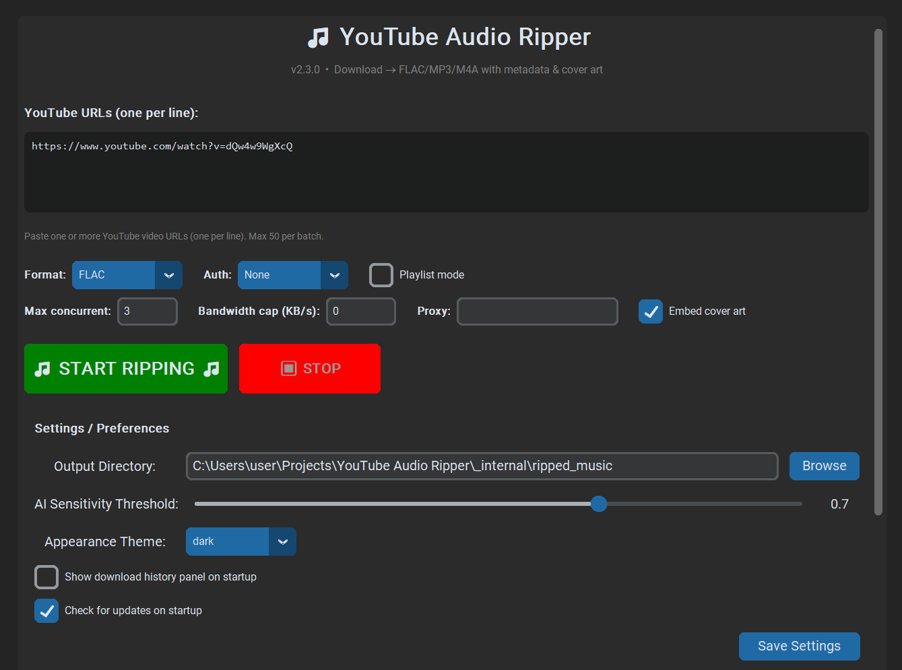

<h1 align="center">YouTube Audio Ripper</h1>

<p align="center"><b>Paste a link, get a FLAC named after the track. Local GUI, no account needed.</b></p>

<p align="center">
  <a href="https://github.com/cjps4linux-creator/Youtube-Audio-Ripper/actions/workflows/ci.yml"></a>
  <a href="https://github.com/cjps4linux-creator/Youtube-Audio-Ripper/releases/tag/v2.3.0"></a>
  
  
  
  
</p>

---

## What it does

A desktop app that downloads audio from YouTube links, converts it to FLAC
(or MP3/M4A), and names each file after the video title. No command line,
no account needed.

### Core workflow

| Step | What happens |
|------|--------------|
| 1 | Paste a YouTube URL into the app |
| 2 | App validates the URL and checks FFmpeg is present |
| 3 | yt-dlp downloads the best available audio |
| 4 | FFmpeg converts to your chosen format (FLAC default) |
| 5 | Metadata (title, artist, album, cover art) is embedded |
| 6 | File is saved with a clean, sanitised name |

### Key features

- **Paste-and-go GUI** — CustomTkinter interface, no command line required
- **Format choice** — FLAC (lossless), MP3, or M4A output
- **Metadata & cover art** — title, artist, album, and embedded thumbnail
- **Smart filenames** — `Rick Astley - Never Gonna Give You Up.flac`, not `001.flac`
- **Batch downloads** — queue multiple URLs, per-file progress, stop anytime
- **Playlist support** — detect and select which videos to rip from a playlist
- **Parallel downloads** — ThreadPoolExecutor for concurrent rips
- **Resume** — interrupted downloads continue where they left off
- **Deduplication** — `downloads.json` registry prevents re-ripping the same track
- **Retry** — exponential backoff (1s, 2s, 4s, max 3 attempts) on failure
- **Cookies-from-browser** — authenticate with Chrome/Edge/Firefox for bot-protected videos
- **Bandwidth limiting** — cap download speed in KB/s
- **Proxy support** — SOCKS5/HTTP proxy configuration
- **Download history** — view past rips, re-download, export to CSV
- **Themes** — Dark / Light / System toggle
- **Keyboard shortcuts** — Ctrl+V paste, Ctrl+Enter start, Escape stop, etc.
- **Portable mode** — create an empty `portable` file next to the EXE to store state locally
- **Auto-updater** — checks GitHub releases on startup, downloads and installs updates
- **FFmpeg bundled** — `ffmpeg.exe` and `ffprobe.exe` ship alongside the EXE
- **Logging** — file + console logs for troubleshooting

## Screenshots

<p align="center"><b>Main Menu</b></p>

<p align="center">
  
</p>

---

## Requirements

### Standalone EXE (recommended — no install needed)

Download `YouTube Audio Ripper.exe` from the [Releases page](https://github.com/cjps4linux-creator/Youtube-Audio-Ripper/releases). `ffmpeg.exe` and `ffprobe.exe` are bundled — nothing else to install.

| Component | Bundled with EXE? |
|-----------|-------------------|
| FFmpeg (`ffmpeg.exe`) | ✅ Yes |
| FFprobe (`ffprobe.exe`) | ✅ Yes |
| Python runtime | ✅ Yes (PyInstaller) |
| All Python dependencies | ✅ Yes |

### Source install (for developers)

| Requirement | Version | Notes |
|-------------|---------|-------|
| Python | 3.11+ | Required to run from source |
| yt-dlp | 2024.1.0+ | Audio downloading |
| CustomTkinter | 5.2.0+ | GUI framework |
| Pillow | 10.0.0+ | Image handling (cover art, themes) |
| pystray | 0.19.0+ | System tray integration |
| pywin32 | 306+ | Windows only — desktop shortcut creation |

Install from `requirements.txt`:

```bash
pip install -r requirements.txt
```

FFmpeg must also be on your system PATH for source installs:

```bash
# Windows (winget)
winget install Gyan.FFmpeg

# macOS (Homebrew)
brew install ffmpeg

# Linux (apt)
sudo apt-get install ffmpeg
```

## Install

### Option 1 — Standalone EXE (recommended)

No installation required. Just download and run:

1. Go to the [Releases page](https://github.com/cjps4linux-creator/Youtube-Audio-Ripper/releases)
2. Download `YouTube Audio Ripper.exe`, `ffmpeg.exe`, and `ffprobe.exe`
3. Place all three in the same folder
4. Double-click `YouTube Audio Ripper.exe`

Optionally, download the [Inno Setup installer script](build/youtube-ripper-setup.iss) to build a one-click Windows installer with Start Menu and desktop shortcuts.

### Option 2 — Source install (for developers)

```bash
# Clone the repo
git clone https://github.com/cjps4linux-creator/Youtube-Audio-Ripper.git
cd Youtube-Audio-Ripper

# Create and activate a virtual environment
python -m venv .venv
.venv\Scripts\activate          # Windows
source .venv/bin/activate       # macOS/Linux

# Install dependencies
pip install -r requirements.txt

# Ensure FFmpeg is on PATH (see Requirements above)
```

## Run

### Standalone EXE

Double-click `YouTube Audio Ripper.exe` — no installation, no command line.

### From source

```bash
python rip_gui.py
```

Or double-click `launch.vbs` / `launch.bat` on Windows.

### Portable mode

Create an empty file named `portable` (no extension) next to the EXE or script. All state (settings, download history, logs) will be stored in the app directory instead of AppData — ideal for running from a USB stick.

## Authentication

YouTube increasingly requires a signed-in session. When a download fails with
`Sign in to confirm you're not a bot`, the app needs browser cookies  -  it
supports `--cookies-from-browser`:

```bash
python rip_gui.py --cookies-from-browser="Chrome"
```

This is YouTube's intended authentication path; there is no bypass.

## Legal note

Download only content you have the right to download. Respect YouTube's Terms
of Service and applicable copyright law in your jurisdiction.

## Licence

MIT  -  see [LICENSE](LICENSE).

---

## Credits

Built by **Conrad CJ Wilson**  -  [GitHub](https://github.com/cjps4linux-creator) · [LinkedIn](https://linkedin.com/in/conradcjwilson)

`conradcjwilson0@gmail.com`

---

## Windows: "Unknown Publisher" Warning

The distributed `YouTube Audio Ripper.exe` is **not code-signed** (no
certificate purchased). On first launch, Windows SmartScreen may show an
"Unknown publisher" warning. Click **More info → Run anyway** — this only
happens once per version.

This is intentional: no budget for a code signing certificate (~$250–$500/year).
If you trust the source, the warning can be safely ignored.

## Download

Get the latest standalone EXE from the
[Releases page](https://github.com/cjps4linux-creator/Youtube-Audio-Ripper/releases).
No installation required — just run the EXE.
